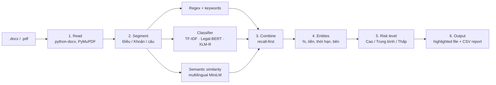

# Legal Clause Analyzer — Trợ lý nhận diện rủi ro hợp đồng pháp lý

**Group 5:** Nguyễn Hoài Khánh · Lê Tuấn Kiệt · Bùi Ngọc Phương Uyên · Dương Gia Bảo

A first-pass review tool for HR and Sales staff. It reads a contract (`.docx` or `.pdf`), flags risky
sentences, explains each one with the key amounts, percentages, durations and parties, and returns the
original file with those sentences highlighted red, plus a summary table.

> **Checkpoint 2 report.** Sections 1–3 below answer the checkpoint questions. Setup instructions are at the end.
>
> *Công cụ chỉ mang tính hỗ trợ sàng lọc, không thay thế tư vấn pháp lý.*

---

## 1. Current project status

### Milestones

| # | Milestone | Status |
|---|---|---|
| 1 | Read `.docx` / text `.pdf`; clear errors for scanned, encrypted or corrupt files | ✅ Done |
| 2 | Split into Điều/Khoản/Article clauses and sentences (Vietnamese + English) | ✅ Done |
| 3 | Regex + keyword baseline for the 5 risk groups (VI + EN) | ✅ Done |
| 4 | CUAD + LEDGAR mapped to our 5 risk groups; leak-free train/val/test split | ✅ Done |
| 5 | TF-IDF classifiers (Logistic Regression, Linear SVM) | ✅ Done |
| 6 | Transformer classifiers (Legal-BERT, XLM-R) fine-tuned on cloud GPUs | ✅ Done |
| 7 | Semantic similarity (STS) against 50 bilingual reference clauses | ✅ Done |
| 8 | Entity extraction (PARTY, MONEY, PERCENT, DURATION, DATE) and Cao / Trung bình / Thấp scoring | ✅ Done |
| 9 | Red highlights + comments in the original Word/PDF; CSV report | ✅ Done |
| 10 | Command-line tool and Streamlit demo (runs only on the local machine) | ✅ Done |
| 11 | Evaluation tools: annotation templates, Cohen's Kappa, method comparison | ✅ Code done |
| 12 | Run the tool on 2 sample contracts (1 labour, 1 commercial): see [`samples/`](samples/README.md) | ✅ Done |

### How it works



A sentence is flagged if **any** method fires (recall-first, as the proposal requires). The level rises when
several methods agree, or when the entities cross a rule. For example, a penalty above **8%** in a commercial
contract (Điều 301 Luật Thương mại 2005), uncapped indemnity ("toàn bộ thiệt hại", "không giới hạn"), or an
indefinite confidentiality term ("vô thời hạn") are all **Cao**. If the user says which side they are
("Tôi là Bên A/B"), obligations that fall on the other party are lowered one level.

### Training data (CUAD + LEDGAR, English)

| Split | none | termination | indemnity | confidentiality | non_compete | penalty | Total |
|---|---|---|---|---|---|---|---|
| train | 101,775 | 16,025 | 9,967 | 5,308 | 3,089 | 314 | 136,478 |
| val | 13,396 | 1,907 | 1,102 | 618 | 374 | 29 | 17,426 |
| test | 14,434 | 1,782 | 1,169 | 601 | 338 | 45 | 18,369 |

Splits are made **by source contract**, so no contract appears in two splits, and duplicate text is removed
across splits. LEDGAR labels are free text (12,608 different labels), so we wrote a mapping. Labels we could not
map with confidence (8,205 rows, e.g. "no premium or penalty") and rows tagged with two risk groups (244) were
dropped.

### Current results: public test set (English, 18,369 rows)

Precision / recall / F1 are macro-averaged over the 5 risk groups. Thresholds were tuned on validation data
for **F2**, which weights recall twice as much as precision.

| Model | Precision | Recall | F1 | Penalty F1 | Indemnity F1 | Confidentiality F1 | Termination F1 | Non-compete F1 |
|---|---|---|---|---|---|---|---|---|
| TF-IDF + Logistic Regression | 0.853 | 0.918 | 0.883 | 0.841 | 0.916 | 0.932 | 0.839 | 0.886 |
| **TF-IDF + Linear SVM** | **0.875** | 0.925 | **0.898** | **0.851** | 0.929 | 0.943 | 0.872 | 0.896 |
| Legal-BERT | 0.857 | **0.929** | 0.891 | 0.745 | **0.946** | **0.945** | **0.899** | **0.920** |
| XLM-R (multilingual) | 0.842 | 0.926 | 0.882 | 0.735 | 0.925 | 0.941 | 0.888 | **0.920** |

What this shows so far:

- **All models reach over 0.91 recall**, which matches the recall-first goal.
- **The Transformers win on 4 of 5 groups but lose clearly on penalty.** Penalty has only 314 training
  examples (45 in test), and TF-IDF copes better with so few. This is why the overall F1 of the simple SVM is
  still the highest.
- **The semantic similarity method catches paraphrases that have no keyword.** For example,
  *"Bên B phải trả thêm một khoản bằng một phần mười giá trị đơn hàng khi giao trễ"* is flagged as penalty
  even though it never says "phạt" (an automated test checks this).

### Early check on Vietnamese text (not yet a formal evaluation)

We fed XLM-R (trained only on English) Vietnamese sentences directly:

| Vietnamese sentence | XLM-R alone |
|---|---|
| Bên A có quyền đơn phương chấm dứt hợp đồng mà không cần báo trước. | ✅ termination (0.93) |
| Người lao động không được làm việc cho đối thủ cạnh tranh trong 12 tháng. | ✅ non_compete (1.00) |
| Bên B bồi thường toàn bộ thiệt hại phát sinh, không giới hạn. | ✅ indemnity (0.61) |
| Bên B phải chịu phạt 12% giá trị hợp đồng nếu giao hàng chậm. | ❌ missed |
| Bên B có nghĩa vụ bảo mật thông tin trong 02 năm… | ❌ missed |
| Hợp đồng có hiệu lực kể từ ngày ký. | ✅ correctly not flagged |

The two misses are caught by the Vietnamese regex rules and the similarity method, so the combined pipeline
still flags them. That is the reason for combining the three methods. The other approach, translating
Vietnamese to English before classifying, looks weak: the local translation model turned *"Bên B phải chịu phạt
12%…"* into *"B takes 12% of the contract value…"* and lost the word "penalty".

### Demo output (sample Vietnamese sales contract, user = "Bên B")

```
[Cao]        Điều 8.2 | Phạt vi phạm        | Bên B phải chịu phạt 12% giá trị hợp đồng nếu giao hàng chậm.
[Cao]        Điều 9   | Bồi thường thiệt hại | Bên B bồi thường toàn bộ thiệt hại phát sinh, không giới hạn.
[Trung bình] Điều 11  | Bảo mật             | Bên B có nghĩa vụ bảo mật thông tin trong 02 năm sau khi chấm dứt hợp đồng.
[Trung bình] Điều 8   | Phạt vi phạm        | Phạt vi phạm            ← heading only (known issue)
[Thấp]       Điều 12  | Bảo mật             | Hợp đồng có hiệu lực kể từ ngày ký.   ← false alarm (known issue)
```

The three real risks are found and ranked as expected: 12% is above the 8% cap so it is **Cao**, uncapped
indemnity is **Cao**, and a 2-year confidentiality term is **Trung bình**. The last two lines were false alarms;
both are fixed (headings are skipped, and a sentence flagged by similarity alone needs a score of at least 0.60).

**The two sample contracts** (a labour contract and a business cooperation agreement) are in
[`samples/`](samples/README.md), with the highlighted Word files and CSV reports the tool produced for each.

### Quality

- **240 automated tests**, all passing. They cover file reading, segmentation, every detector, entities,
  scoring, highlighting, the full pipeline, the demo app and the evaluation tools.
- Contracts never leave the machine. Only public CUAD/LEDGAR data is used on the cloud GPU, and inference runs
  offline.

---

## 2. Improvements since Checkpoint 1

At Checkpoint 1 we had the proposal: the problem, the 5 risk groups, the 3-method design and the research
questions. Since then we have built and tested the whole pipeline.

### New modules

| Module | What it does |
|---|---|
| `lca/reader.py` | Reads Word (including table cells) and text PDFs. Removes repeated headers and footers. Explains scanned, password-protected or corrupt files instead of returning an empty "no risk" result. |
| `lca/segmenter.py` | Splits by Điều/Khoản/Article first, then sentences, then items `a) b) c)` and `;`. Keeps exact offsets into the original file so highlights land on the right words. Handles Vietnamese text stored in decomposed Unicode, which is common in PDFs. |
| `lca/detectors/regex_rules.py` | VI + EN patterns for all 5 groups, with rules for negation ("không bị phạt") and definitions ("Thông tin mật là…") to cut false alarms. |
| `lca/data/` | Turns CUAD and LEDGAR into one labelled dataset for our 5 groups. |
| `lca/train/`, `modal_train.py` | TF-IDF training locally; Transformer training on Modal cloud GPUs. |
| `lca/detectors/sts.py` | Similarity to 50 reference clauses (10 per group, half Vietnamese). |
| `lca/ner.py`, `lca/scoring.py` | Extracts entities and assigns the risk level with legal rules. |
| `lca/writers.py` | Red highlight plus a Word comment ("Phạt vi phạm – Mức Cao: …") or a PDF note, and a CSV that opens correctly in Excel. |
| `lca/pipeline.py`, `lca/cli.py`, `app.py` | End-to-end run, command-line tool, and Streamlit demo with level filter and downloads. |
| `lca/eval/` | Annotation templates, Cohen's Kappa, and a comparison script that writes the RQ1–RQ3 answers, confusion matrices and an error list. |

### Improvements to the original plan

- **Leak-free evaluation.** Splitting by contract (not by row) and removing duplicates across splits keeps test
  scores honest. LEDGAR has much repeated boilerplate that would otherwise inflate them.
- **No false "safe" examples.** CUAD has no indemnity or confidentiality labels, so unlabelled CUAD sentences
  that mention those topics are not used as "no risk" examples.
- **Recall-first thresholds.** Each risk group gets its own threshold, tuned for F2 on validation data, instead
  of a fixed 0.5.
- **Long clauses.** The Transformer reads long text in overlapping windows, so a risky phrase at the end of a
  long clause is not cut off.
- **Party-aware scoring**, as listed under "Hạn chế" in the proposal: the user can say which side they are.

### Problems found and fixed

| Problem | Fix |
|---|---|
| The official CUAD entry on Kaggle contains only a README. | Used a complete mirror (510 contracts, 41 categories). |
| Installing the new libraries would have upgraded `transformers` and broken other projects in the shared environment. | Installed with the existing versions pinned; nothing else changed. |
| On equal scores, threshold tuning picked the higher threshold, which hurt recall. | Ties now pick the lower threshold (recall-first). |
| A pandas 3 change dropped the label column in our sampling code; the first cloud test run crashed. | Reproduced in a test, then fixed. |
| Training on a T4 GPU would take about 70 minutes per model. | Moved to an RTX PRO 6000 with bf16: about 15 steps/s vs 3.2, roughly **7 minutes** of training per model. |
| Uploading data to the cloud by hand. | The cloud job now downloads CUAD/LEDGAR from Kaggle itself and rebuilds the same splits (checked: identical counts). |

---

## 3. Next steps

### Remaining tasks

1. **Collect and label the 2 sample contracts** (1 labour contract, 1 sales/service contract or NDA).
   `python -m lca.eval.annotate template …` creates one sheet per member; each member labels every sentence on
   their own; `… consensus …` computes Cohen's Kappa and lists disagreements to resolve together.
2. **Run the evaluation** (`python -m lca.eval.compare`) to answer:
   - **RQ1:** how well regex alone does on real contracts;
   - **RQ2:** clause vs sentence splitting;
   - **RQ3:** whether combining methods raises recall without losing too much precision;
   - **Vietnamese route:** XLM-R direct vs translate-then-classify.
3. **Choose the final default method combination** based on those results.

### Planned improvements

- ~~**Stop flagging headings.**~~ Done: title lines such as "Điều 8. Phạt vi phạm" are no longer reported.
- ~~**Reduce similarity false alarms.**~~ Done: a sentence flagged by similarity alone needs a score of at
  least 0.60, and similarity alone no longer triggers the 8% penalty cap below 0.70. On the sample business
  contract the findings went from 27 to 4 with no real risk lost. Some Thấp false alarms remain.
- **Better Vietnamese penalty and confidentiality detection.** Add a small set of self-labelled Vietnamese
  sentences (planned in the proposal) and more Vietnamese reference clauses.
- **More penalty data.** Penalty is the smallest group (388 examples in total) and the weakest for the
  Transformers.
- **Check a tokenizer warning** printed when loading the XLM-R model.
- **Error analysis** of false positives and false negatives on the sample contracts for the final report.

### Timeline

Proposed; we will adjust it to the course's final deadline.

| Week | Work |
|---|---|
| 2 – 8 Nov | Collect the 2 contracts; each member labels them; compute Kappa and agree on ground truth. |
| 9 – 15 Nov | Run the evaluation (RQ1–RQ3); fix heading and false-alarm issues; add Vietnamese examples. |
| 16 – 22 Nov | Error analysis; choose final defaults; retrain if the data changes. |
| 23 Nov → deadline | Final report, slides and live demo. |

---

## Running the project

```bash
# Python 3.11 environment with the packages in requirements (torch, transformers, sentence-transformers,
# spacy + en_core_web_sm, underthesea, pymupdf, python-docx, scikit-learn, streamlit, modal)

python -m pytest                                   # 240 tests

# Data and models (data/ and artifacts/ are not in git: they are large)
kaggle datasets download konradb/atticus-open-contract-dataset-aok-beta -p data/cuad --unzip
kaggle datasets download chipthui1306/ledgar -p data/ledgar --unzip
python -m lca.data.prepare                         # → data/processed/{train,val,test}.parquet
python -m lca.train.tfidf_train                    # → artifacts/models/tfidf_*.joblib
python -m lca.detectors.sts                        # → artifacts/models/sts_thresholds.json
modal run modal_train.py::prepare_data             # cloud: download from Kaggle and build splits
modal run --detach modal_train.py::train --model-name xlm-roberta-base --run-name xlmr
modal volume get legal-clause-models /xlmr/final artifacts/models/xlmr/

# Use it
python -m lca.cli hop_dong.docx --type commercial --party "Bên B"
streamlit run app.py                               # http://localhost:8501
```

## Repository layout

```
lca/            pipeline code (reader, segmenter, detectors/, ner, scoring, writers, pipeline, cli)
lca/data/       CUAD + LEDGAR → risk-group dataset
lca/train/      TF-IDF training and shared training helpers
lca/eval/       metrics, annotation, method comparison
modal_train.py  cloud GPU training on Modal
app.py          Streamlit demo
tests/          automated tests
reports/        metrics and thresholds
docs/           implementation plan
```

## References

CUAD (Hendrycks et al., 2021) · LEDGAR (Tuggener et al., 2020) · LEGAL-BERT (Chalkidis et al., 2020) ·
Sentence-BERT (Reimers & Gurevych, 2019) · Luật Thương mại 2005, Điều 300–302.
